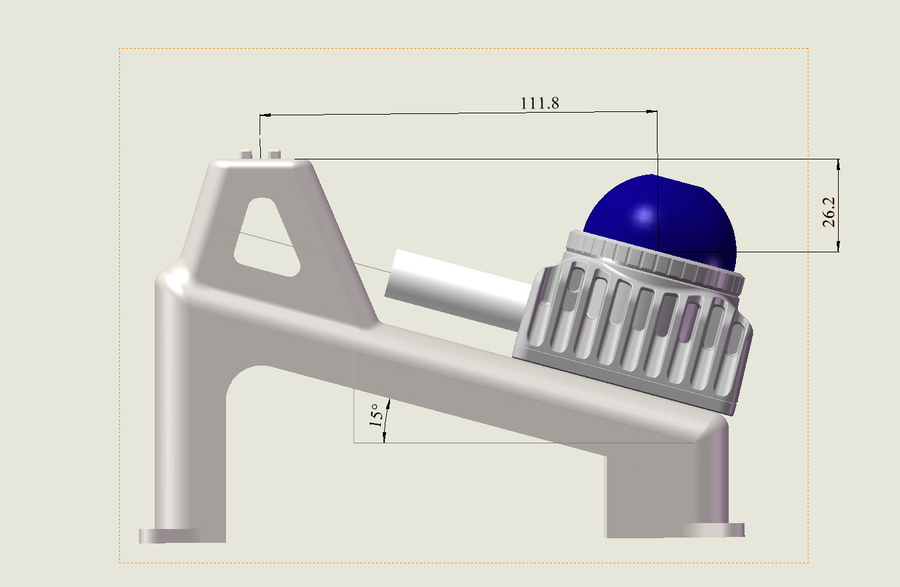
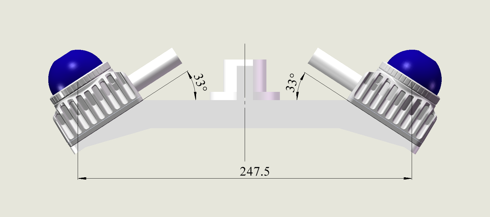

# 双 MID-360S + Insta360 X4 Air 标定

以 `lidar-camera-imu-calibration` 的采集、CAD 初值、求解、导出方式为参考。设备是两台 Mid-360S 和一台 Insta360 X4 Air，不是 D435i。入口脚本是 `./calibrate.sh`，`./calibrate.sh help` 列出全部命令。

**English:** Calibration workspace for two MID-360S lidars and one Insta360 X4 Air. Entry point is `./calibrate.sh`. The calibration chain is lidar-to-lidar (IMU leveling + ICP), camera intrinsics (derived from the stitching parameters), then panorama-to-front-lidar (targetless NID).

## 单雷达模式（当前 `config/rig.yaml`）

当前装法：一台 MID-360S（192.168.1.112）倾斜装在 Insta360 正前方，主机 192.168.1.5。`config/rig.yaml` 里只列一台雷达时，脚本自动走单雷达流程；双雷达配置保存在 `config/rig_dual_mid360s.yaml`，旧结果在 `results/archive/dual_mid360s_20261022/`。

结构图 `doc/insta360_mid360s.png`（侧视）：



- 雷达光学中心在相机安装面前方 **111.8 mm**、下方 **26.2 mm**
- 雷达安装面倾斜 **15°**：雷达 Z 轴前倾，X 轴（前向，线缆在后）下俯 15°。`level` 会把 IMU 测得的倾角和 `geometry.lidar_tilt_deg` 对比
- 相机直接立在定位销上。X4 Air 机身高 **113.8 mm**（官方规格 46 × 113.8 × 37 mm），镜头中心约在机顶下 22 mm（估计），所以镜头中心高出安装面约 **92 mm**

1. 相机初值写在 `geometry.camera_from_lidar_mm: [x, y, z]`（mm，`lidar_level` 系：x 为雷达前向、z 向上）。按图纸为 `[-111.8, 0, 26.2 + 镜头中心高度]`，当前是 `[-111.8, 0, 118.2]`。只用作初值，几厘米误差没关系：搜索范围是 xy ±100 mm、z ±90 mm，并把同样的水平距离转到 12 个方向各试一次。
2. `./calibrate.sh bringup`：起雷达、相机和 `apply`。只测雷达用 `./calibrate.sh bringup-lidar`（不碰相机）。
3. `./calibrate.sh level <scene>`：**雷达静止**，采 5 帧点云和 2 s IMU，用重力求横滚、俯仰，写 `results/lidar_extrinsic.json`（`T_level_front`，`status: imu_level`）。IMU 加速度标准差大于 0.01 g 时会警告，需要重采。完成后重启 `apply`。
4. `./calibrate.sh cam-record scene01` … 共录 3-5 个场景。点云直接用 `/livox/front_lidar/points`。场景要有 1-3 m 内的结构，位置平移才约束得住；雷达在相机正前方，全景中间那一块会被雷达自身挡住。
5. `./calibrate.sh cam-calib`：先做 yaw 和位置的初值搜索，再用 NID 精化，结果写 `results/insta360_extrinsic.json`（`T_front_insta360`、`T_level_insta360`）。初值不对时，用 `cam-initial-manual` 加 `cam-solve`。
6. 在 DA360 侧用 `import_calib.sh` 导入。`calib_io.py` 允许没有 `T_level_rear`。

单雷达模式下 `initial`、`refine-auto`、`refine-manual` 没有意义，会提示改用 `level`。

**English:** Single-lidar mode, selected automatically when `config/rig.yaml` lists one lidar.

1. Put the rough camera offset in `geometry.camera_from_lidar_mm`.
2. Run `bringup`, or `bringup-lidar` to start the lidar without the camera.
3. Run `level <scene>` with the rig still. This gives IMU roll and pitch in `T_level_front`.
4. Record 3–5 scenes with `cam-record`.
5. Run `cam-calib`, which does a yaw and position search followed by NID. The fallback is `cam-initial-manual` plus `cam-solve`.
6. Import into DA360.

The dual layout is kept in `config/rig_dual_mid360s.yaml`.

## 安装关系

图纸 `doc/mid360s_2_insta360.png`，实物 `doc/install_action.jpg`：



- 两台雷达光学中心水平间距 **247.5 mm**
- 每台雷达相对水平面倾斜约 **33°**，具体的横滚和俯仰由各自内置 IMU 的重力方向测得
- 后雷达相对前雷达绕 Z 轴 **180°**，两台水平朝向互为镜像
- Insta360 在两雷达的对称中心上方。图纸没有标高度，`geometry.camera_dz_mm` 里的 180 mm 是按照片估的初值

雷达按安装方位命名，不按 IP。前雷达 `front_lidar` 是主雷达，后雷达 `rear_lidar`。IP 只写在 `config/rig.yaml`，换雷达后只改那里的 `ip`，再重新 `./calibrate.sh bringup`。

| 设备 | 地址（rig.yaml） | 话题 |
|---|---|---|
| `front_lidar`，主雷达 | 192.168.1.112 | `/livox/front_lidar/points`、`/livox/front_lidar/imu` |
| `rear_lidar` | 192.168.1.197 | `/livox/rear_lidar/points`、`/livox/rear_lidar/imu` |
| Insta360 X4 Air | 本机 USB 3.0，Android 模式 | `/insta360/...`，见“相机实时视图” |
| 主机网口 | 192.168.1.5（enp129s0） | 两台雷达都把目的地址指到这里 |

驱动本身按 IP 命名话题（`/livox/lidar_<ip>`）。`./calibrate.sh bringup` 根据 rig.yaml 用 `-r` 把它们重映射成上表的方位话题，其他工具只用方位话题。

## 坐标系

- `front_lidar`、`rear_lidar`：各雷达自己的原始坐标
- `lidar_level`：重力水平帧。原点在前雷达，Z 轴与重力相反，yaw 跟前雷达一致。融合点云统一在这个坐标系
- `insta360`（相机机身）：X 向前，对着全景图中心；Y 向左；Z 向上
- `insta360_<view>_optical`：四个视图的光学坐标系，z 向前、x 向右、y 向下

```
p_level = T_level_front · p_front = T_level_rear · p_rear
p_front = T_front_rear · p_rear
p_front = T_front_insta360 · p_insta360
p_front = T_front_view · p_view,  T_front_view = T_front_insta360 · R_body_optical(view)
```

## 传感器标定：方法与步骤

### 整体思路

标定链以前雷达为基准，分三步，后一步依赖前一步的结果：

| 步骤 | 求什么 | 方法 | 结果文件 |
|---|---|---|---|
| 1. 雷达-雷达 | `T_front_rear`、`T_level_front`、`T_level_rear` | 安装初值 + 每台雷达 IMU 测重力扳平 + 多级 ICP | `results/lidar_extrinsic.json` |
| 2. 相机内参 | 四个视图的 `K`、`R_body_optical` | 由拼接和重投影参数直接推算，不需要测量 | `results/insta360_intrinsics.json` |
| 3. 相机-主雷达 | `T_front_insta360`、`T_level_insta360` | 全景图对融合点云的无靶标 NID 配准 | `results/insta360_extrinsic.json` |

相机只标一个外参：整台 Insta360 是刚体，全景图对 `front_lidar`。四个视图相对机身的旋转是由参数算出的，所以每个视图的外参由这一个外参推出，不分方位单独标定。分方位标定会让四个视图各自有误差，彼此还不一致。全景图一次覆盖 360°，配合两台雷达融合后的整圈点云，约束也更强。

所有标定都要求设备**静止**，并且环境里有足够的结构，比如墙角、门窗、柜子和桌子。录制时画面里不要有人走动。

### 第 0 步：准备

1. 编译驱动和相机节点（只做一次）：

   ```bash
   ./scripts/build_driver.sh
   ./scripts/build_insta360.sh
   ```

2. 相机：用 USB 3.0 连接主机，在弹出的模式菜单里选“安卓手机控制”。第一次选过后，相机会记住这个模式。普通用户需要装一次 udev 规则，见“驱动与 SDK”。
3. 供电：安卓模式要求 USB 口稳定提供 5V 3A。电脑 USB 口供电不足时，相机可能断连，长时间使用建议接带电源的 USB 3.0 Hub。
4. 启动并检查：

   ```bash
   ./calibrate.sh status
   ./calibrate.sh bringup        # 两台雷达、apply 和相机节点；后台运行用 bringup-bg
   ```

   在 Foxglove 里确认 `/livox/front_lidar/points`、`/livox/rear_lidar/points` 和 `/insta360/front/image/compressed` 都有数据。

### 第 1 步：雷达-雷达外参

**方法**

1. **安装初值**：后雷达绕 Z 转 180°，平移 `[-247.5, 0, 0] mm`，不含俯仰和横滚。
2. **重力扳平**：每台雷达静止采集约 2 s 的 IMU，用加速度均值得到重力方向，算出各自的横滚和俯仰，把点云转到水平。
3. **配准**：两台雷达各取一帧静态点云。从安装初值的 yaw 和平移出发，先用较大的对应距离做点到点 ICP，再逐级收紧，最后做对应距离 0.10 m 的点到面 ICP。
4. **组合**：得到 `T_front_rear`，并由扳平结果得到 `T_level_front`、`T_level_rear`。

**步骤**

```bash
./calibrate.sh initial                 # 写安装初值 results/lidar_extrinsic.initial.json 和 lidar_extrinsic.json
./calibrate.sh refine-auto scene01     # 录一帧 PCD 和约 2 s IMU，从安装初值做多级配准
./calibrate.sh refine-manual           # 可选：键盘微调，Foxglove 看 /calib/lidar_fused，z 保存
kill "$(cat .run/extrinsic.pid)"; ./calibrate.sh apply   # 重启 apply，用上新外参
```

- `refine-auto` 在场景目录没有 PCD 或 IMU 文件时会自动录制：`front_lidar.pcd` 和 `front_lidar.imu.json`，后雷达同理。同一场景名已有文件时不会重录。
- 精标总是从 `lidar_extrinsic.initial.json` 起步，不会覆盖初值文件。
- `./calibrate.sh record <scene>` 和 `./calibrate.sh insta360 <scene>` 可以另外留存 15 s 的原始 bag 和一张机内拼接照片，作为记录。

**验收**

- `lidar_extrinsic.json` 里的 `quality`：重叠比例高，RMSE 小。重叠不足时结果仍会写回，但会打印 WARNING，这时换一个结构更多的位置重做。
- 在 Foxglove 里把固定坐标系设为 `lidar_level`，查看 `/extrinsic/lidar_fused`：两台雷达重叠区域的墙面和地面不应有重影，地面应当水平。

### 第 2 步：相机四视图内参

**方法**

相机节点先用 Media SDK 把双鱼眼拼成等距柱状全景（FlowState 关闭，画面固定在机身上），再重投影成前、左、后、右四个无畸变针孔视图。所以内参由参数决定，不需要测量：

- 视图 640×640，水平视场 90°，`fx = fy = 320`，`cx = cy = 319.5`，`D` 全为 0
- 视图 yaw：前 0°、左 +90°、后 180°、右 −90°。由此得到各视图相对机身的旋转 `R_body_optical`

**步骤**

```bash
./calibrate.sh intrinsics              # 写 results/insta360_intrinsics.json；camera 和 bringup 启动时也会自动重写
```

改了 `config/insta360_views.yaml` 里的视图尺寸、视场或 `front_yaw_deg` 后要重新生成。

### 第 3 步：相机-主雷达外参

**方法**

求解用 [koide3/direct_visual_lidar_calibration](https://github.com/koide3/direct_visual_lidar_calibration) 的 Docker 镜像（`camera_lidar.solver_image`），相机模型选 `equirectangular`。

1. **点云**：默认使用 `/extrinsic/lidar_fused_front`，即后雷达用第 1 步的 `T_front_rear` 转到 `front_lidar` 后与前雷达融合，覆盖整圈全景。设 `camera_lidar.cloud: front` 则只用前雷达。所以第 1 步要先做完，并且 apply 已经用上新外参。
2. **预处理**：每个场景取第一帧全景图，累积整段点云，生成点云强度图。
3. **自动初值**（`tools/insta360_lidar_calib.py initial`）：
   - 平移：把相机放在两雷达中点上方 `geometry.camera_dz_mm` 处。
   - yaw：在水平系下把点云强度渲染成全景图，和相机全景图的边缘做循环相关（yaw 变化等于全景图横向平移）。同时在 ±90 mm 范围内以 30 mm 步长搜索高度。
   - 打印相关峰值和次高峰的比值，低于 1.2 时打印 WARNING。
4. **精标**：以点云强度与全景图灰度的 NID（归一化信息距离）为目标做无靶标优化。多个场景联合求解，有显示器时用 GPU 做遮挡剔除。
5. **导出**：由 `T_front_insta360` 推出 `T_level_insta360` 和四个视图的 `T_front_view`，并生成叠加图。

拼接方式固定为 `stitch_type: template`，标定和使用时的成像几何才一致。改拼接方式后要重新标定。

**步骤**

```bash
./calibrate.sh bringup                 # 雷达、apply 和相机节点
./calibrate.sh cam-record scene01      # 设备静止，录 5 s（camera_lidar.record_seconds）
#   换位置或朝向后，再录 scene02、scene03 ...，共 3-5 个场景
./calibrate.sh cam-calib               # 用 <ws>/data/calib_capture/camera/bags/ 下的全部场景；也可以列出场景名
```

- `cam-record` 先确认全景图和融合点云都有数据，录完检查各话题的消息数不为 0。bag 存在 `<ws>/data/calib_capture/camera/bags/<scene>`，同名不覆盖。录坏了就删掉这个目录重录。
- `cam-calib` 在 `<ws>/data/calib_capture/camera/runs/<UTC>/` 下建运行目录（`latest` 指向最近一次），依次执行预处理、自动初值、NID 精标和导出，最后写入 `results/insta360_extrinsic.json`。
- 场景要求：离相机 1 m 以外要有强度和几何都有变化的结构（求解器会丢掉 1 m 以内的点）。各场景之间换位置或朝向。

自动初值不对时（峰值比低，或初值叠加图明显错位）：

```bash
./calibrate.sh cam-initial-manual      # 在界面里右键点云和图像上的同一点，加 4 对以上，Estimate、Save 后关闭
./calibrate.sh cam-solve               # 从手动初值重新精标并导出；也可以指定 calib_capture/camera/runs/ 下的某次运行
```

**验收**

1. 自动初值的峰值比 ≥ 1.2。
2. `refined_minus_initial` 较小，说明精标没有跑到别的局部极小值。
3. `<ws>/data/calib_capture/camera/runs/latest/overlay/` 里的叠加图（颜色表示距离）：
   - `<scene>_equirect.jpg`：全景图
   - `<scene>_{front,left,rear,right}.jpg`：四个视图
   - `<scene>_initial.jpg`：初值

   柱子、门框、柜子边缘和桌面应当与点云边界重合。
4. 场景间一致性：分别用每个场景单独求解，结果应当和多场景联合结果接近。
5. `T_level_insta360` 的横滚和俯仰应接近 0，平移应接近安装位置（两雷达中点上方十几厘米）。

工具不会自动判断标定精度，也不给出精度数值。

### 何时需要重新标定

| 变化 | 重做 |
|---|---|
| 雷达拆装、支架变形 | 第 1 步，然后第 3 步 |
| 相机拆装或转动 | 第 3 步 |
| 改 `stitch_type`、全景宽度 | 第 3 步 |
| 改视图尺寸、视场、`front_yaw_deg` | 第 2 步（视图外参会随之重新推算） |
| 只换雷达 IP | 不需要重标，改 `config/rig.yaml` 即可 |

## 运行时使用

`./calibrate.sh apply`（`bringup` 也会启动它，`view` 等同于它）在启动时读一次 `results/lidar_extrinsic.json`，发布以下话题：

| 话题 | 坐标系 | 内容 |
|---|---|---|
| `/extrinsic/front_lidar`、`/extrinsic/rear_lidar` | `lidar_level` | 各自扳平后的点云 |
| `/extrinsic/lidar_fused` | `lidar_level` | 重力水平帧下的融合点云，Foxglove 固定坐标系用 `lidar_level` |
| `/extrinsic/lidar_fused_front` | `front_lidar` | 主雷达坐标系下的融合点云，相机标定用；只在有订阅者时计算 |

精标写回文件后要重启 apply 才会用上新外参。水平是标定时静止测得的安装姿态，不是逐帧的动态补偿。支架整体倾斜后，融合点云会跟着倾斜。

### 相机实时视图

`./calibrate.sh bringup` 会同时启动相机节点，单独启停用 `./calibrate.sh camera` 和 `./calibrate.sh camera-stop`，日志在 `.run/insta360.log`。没编译或没插相机时雷达照常启动，节点会等相机插上后自动连接，断开 5 s 后自动重连。

流程：Camera SDK 预览流（双鱼眼）→ Media SDK `RealTimeStitcher` 拼成等距柱状全景 → 重投影成前、左、后、右四个针孔视图。

| 话题 | 内容 |
|---|---|
| `/insta360/{front,left,rear,right}/image/compressed` | JPEG，默认 640×640，水平视场 90°，四个拼成一圈 |
| `/insta360/{front,left,rear,right}/camera_info` | 无畸变针孔内参，`fx = 320` |
| `/insta360/equirect/image/compressed` | 拼接后的全景，默认 1920×960 |

参数在 `config/insta360_views.yaml`。前视图对准全景图中心，`front_yaw_deg` 可整体转动四个视图（正值向左）。两颗鱼眼的拼接缝在左右两侧，所以左、右视图中间有接缝。`template` 拼接的 CPU 占用约为 `dynamic` 的一半。

节点不链接系统 OpenCV，因为 `libMediaSDK.so` 自带 OpenCV 4.7。

`./calibrate.sh insta360 <scene>` 用 `tools/insta360_capture.cpp` 拍一张机内拼接的照片。相机同一时间只能被一个程序打开，拍照前先 `./calibrate.sh camera-stop`。

## 结果文件

`results/export/` 放下面四份文件的副本，给外部工程使用：

- 何时自动更新：`initial`、`refine-auto`、`refine-manual`、`intrinsics`、`camera`（含 `bringup`）和 `cam-calib`/`cam-solve` 写完结果后会自动同步
- 手动同步：`./calibrate.sh export`
- `insta360_projection/`：相机标定所用的某一个场景（默认第一个，`./calibrate.sh export --scene scene02` 可指定），用当前外参把点云投到全景图和四个视图上，颜色表示距离。`<scene>_overview.jpg` 上面是全景，下面是前、左、后、右四个视图
- 某份文件还没生成时会跳过，并打印提示

`results/` 下的文件：

- `lidar_extrinsic.initial.json`：安装初值，`installation_seed` 是 yaw 180° 和 `[-247.5, 0, 0] mm`，由 `./calibrate.sh initial` 写入，精标不会覆盖
- `lidar_extrinsic.json`：当前雷达外参。`result` 一段给出以下各项：
  - `T_front_rear`、`T_level_front`、`T_level_rear`
  - 水平帧内的 `T_front_rear_level`
  - 安装初值，以及精标相对初值的差

  `leveling` 是每台雷达由 IMU 测得的横滚和俯仰，`quality` 是重叠比例和 RMSE
- `insta360_intrinsics.json`：四个视图各自的以下各项，由 `config/insta360_views.yaml` 推算得到，和节点发布的 `camera_info` 一致：
  - `K`、`D`（全 0）
  - 尺寸、视场、话题、`frame_id`
  - 视图相对机身的旋转 `R_body_optical`
- `insta360_extrinsic.json`：
  - `T_front_insta360`：相机机身在 `front_lidar` 中的位姿
  - `T_level_insta360`：同一外参在 `lidar_level` 中的表示
  - `views.<view>.T_front_view`：四个光学坐标系各自的外参
  - 初值和精标相对初值的差
  - `calibration`：所用的运行目录、场景、话题和拼接方式

姿态统一用欧拉角 `rpy_deg`（roll、pitch、yaw，单位度，`R = Rz(yaw)·Ry(pitch)·Rx(roll)`），平移用 `t_mm`（毫米）。4×4 矩阵的单位是米。外部工程的用法：

- 两台雷达的相对外参用 `T_front_rear`
- 融合到重力水平帧用 `T_level_front` 和 `T_level_rear`
- 相机到主雷达用 `T_front_insta360`，单个视图用 `T_front_view`

全景深度估计（DA360）实时链路：把 `results/export/` 导入旁边的 `../DA360/calib/`（`bash ../DA360/scripts/import_calib.sh`），在 DA360 里运行 `python live_ros.py`，订阅 `/insta360/equirect/image/compressed`，在 `lidar_level` 下输出 `/da360/depth_global` 与 `/da360/points_level`。说明见 `../DA360/README.md` 的 “Live Insta360 X4 Air → global depth”。

全景深度估计（DA360）实时链路：把 `results/export/` 导入旁边的 `../DA360/calib/`（`bash ../DA360/scripts/import_calib.sh`），在 DA360 里运行 `python live_ros.py`，订阅 `/insta360/equirect/image/compressed`，在 `lidar_level` 下输出 `/da360/depth_global` 与 `/da360/points_level`。说明见 `../DA360/README.md` 的 “Live Insta360 X4 Air → global depth”。

## 驱动与 SDK

驱动和 Livox SDK 已拷在本目录，不使用 `livox_mid360s_ws`：

- `drivers/livox_ros_driver2/` — ROS 2 驱动源码，双雷达 launch 为 `launch_ROS2/dual_mid360s_launch.py`
- `drivers/livox_lidar_sdk/` — `liblivox_lidar_sdk_shared.so` 和头文件
- `./scripts/build_driver.sh` — 编译到本目录的 `install/`

Insta360 桌面 SDK 和它的接口说明（本地放在 `doc/insta360/`）需要向 Insta360 官方申请，不在仓库里（已加入 `.gitignore`）：

- Insta360 SDK 在工程根目录 `<ws>/insta360_driver/`（不在 `src/` 下，避免重复占空间）：
  - `insta360_sdk/`：Camera SDK 2.1.8（`include/`、`lib/`、`lib_aarch64/`）
  - `insta360_media_sdk/`：Media SDK 3.1.5。用 `dpkg-deb -x MediaSDK-3.1.5-linux-amd64.deb tmp` 解出后放到这里，再拷入 `include/`。不需要 sudo 安装 deb
  - 本包 `drivers/insta360_*` 为指向上述目录的符号链接

普通用户默认没有相机 USB 节点的写权限，需要装一次 udev 规则（`python3 tools/check_insta360_usb.py` 会检查）：

```bash
sudo cp config/udev/99-insta360.rules /etc/udev/rules.d/
sudo udevadm control --reload-rules && sudo udevadm trigger --attr-match=idVendor=2e1a
```

相机-雷达求解器镜像：`docker pull koide3/direct_visual_lidar_calibration:jazzy`。

数据目录：

- 采集数据在工程根目录 `<ws>/data/calib_capture/`（不在本包 `src/` 下，方便提交代码）：
  - `lidar/bags/`、`lidar/clouds/`：雷达标定数据
  - `camera/bags/`、`camera/runs/`：相机标定 bag 与求解运行目录
  - `camera/stills/`：`insta360` 机内拼接静图
- 运行时结果仍发布到 `<ws>/data/calib/`（`./calibrate.sh publish`）

这些目录都不进 git。
